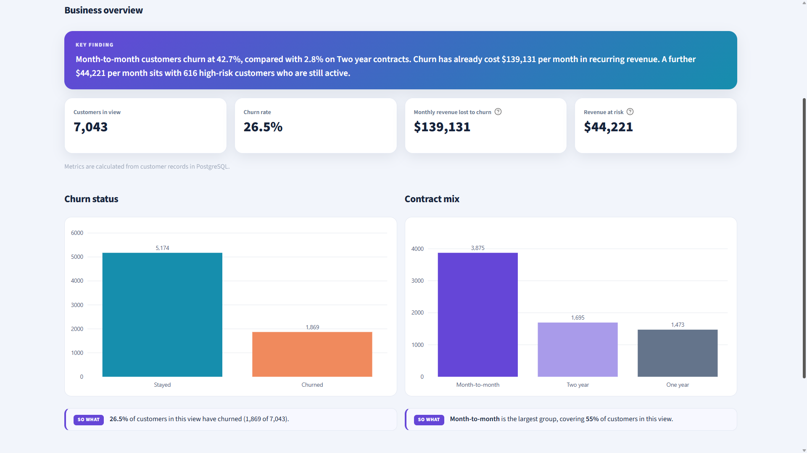
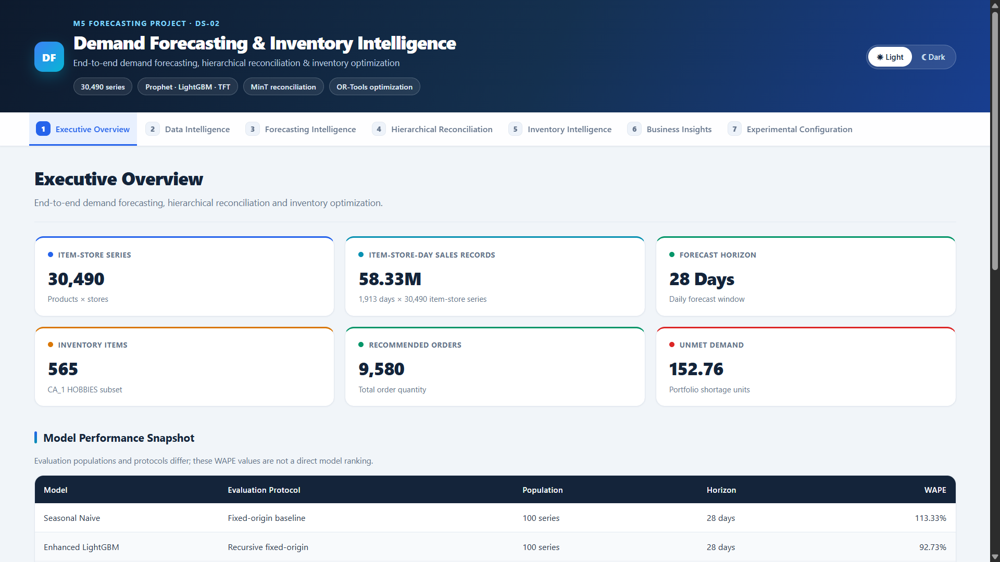

# Nexvia | Data Science & Analytics Projects

A portfolio of end-to-end data science projects built during the Nexvia internship program. Each project goes from raw data to modelling to an interactive dashboard that presents the results to a business audience.

| # | Project | Domain | Dashboard | Highlights |
|---|---|---|---|---|
| 01 | [Customer Lifetime Value & Churn Intelligence](./DS-01-Customer-Lifetime-Value-and-Churn) | Customer analytics | Streamlit | Churn models · SHAP · survival analysis · retention ROI |
| 02 | [Demand Forecasting & Inventory Optimization](./DS-02-Demand-Forecasting-and-Inventory-Optimization) | Retail forecasting and operations | Plotly Dash | Prophet · LightGBM · TFT · MinT reconciliation · OR-Tools |

---

## 01. Customer Lifetime Value & Churn Intelligence

An end-to-end customer analytics system built on the IBM Telco Customer Churn dataset. It finds who is likely to leave, why they leave, how long customers stay, and what a retention campaign could be worth.



**Key features**

- Customer churn prediction with Logistic Regression and LightGBM
- Model explainability with SHAP (model influence, not causation)
- Customer segmentation and lifetime value analysis
- Survival analysis with Kaplan-Meier curves and a Cox proportional hazards model
- Retention ROI scenario simulation with adjustable assumptions
- Interactive Streamlit dashboard with Light and Dark themes

**Tech stack:** Python, Pandas, Scikit-learn, LightGBM, SHAP, Lifelines, Streamlit

**Run it**

```bash
cd DS-01-Customer-Lifetime-Value-and-Churn
pip install -r requirements.txt
streamlit run app.py
```

[Project folder](./DS-01-Customer-Lifetime-Value-and-Churn) · [Dashboard code](./DS-01-Customer-Lifetime-Value-and-Churn/app.py)

---

## 02. Demand Forecasting & Inventory Optimization

An end-to-end demand forecasting and inventory optimization system built on the M5 Forecasting (Walmart) dataset. It forecasts demand, keeps forecasts consistent across the product hierarchy, measures forecast uncertainty and turns forecasts into replenishment recommendations.



**Key components**

- Forecasting with Seasonal Naive, Prophet, LightGBM and Temporal Fusion Transformer (TFT)
- Model evaluation: fixed-origin comparison on 100 series and rolling LightGBM evaluation on all 30,490 series
- Prediction intervals with empirical coverage checks
- Hierarchical forecast reconciliation with Darts (MinT) and coherence validation
- Inventory optimization and order planning with Google OR-Tools
- Seven-page interactive Plotly Dash dashboard with Light and Dark themes

**Headline results**

| Measure | Result |
|---|---|
| Best model on the same 100-series fixed-origin test | TFT, WAPE 85.40% |
| LightGBM on all 30,490 series (rolling one-day-ahead) | WAPE 69.85% |
| Reconciliation coherence (568 components) | Max error 0.0005493 against a tolerance of 0.001 |
| Inventory optimization (565 items) | 9,580 units recommended, 472 OPTIMAL and 93 FEASIBLE solutions |

Inventory stock, lead times and costs are simulated assumptions, because M5 has no real inventory data. WAPE values from different populations and protocols are not directly comparable.

**Tech stack:** Python, Pandas, NumPy, Prophet, LightGBM, PyTorch Forecasting (TFT), Darts, Google OR-Tools, Plotly, Dash

**Run it**

```bash
cd DS-02-Demand-Forecasting-and-Inventory-Optimization
pip install -r requirements.txt
python models/dashboard/enterprise_dashboard.py
# open http://localhost:8051
```

[Project folder](./DS-02-Demand-Forecasting-and-Inventory-Optimization) · [Dashboard code](./DS-02-Demand-Forecasting-and-Inventory-Optimization/models/dashboard/enterprise_dashboard.py)

---


## Repository Structure

```text
Nexvia/
├── DS-01-Customer-Lifetime-Value-and-Churn/
│   ├── csv files/
│   ├── models/
│   ├── screenshots/
│   ├── app.py
│   ├── README.md
│   └── requirements.txt
│
├── DS-02-Demand-Forecasting-and-Inventory-Optimization/
│   ├── docs/
│   │   └── screenshots/
│   ├── models/
│   │   ├── dashboard/
│   │   ├── darts_reconciliation/
│   │   ├── forecast_evaluation/
│   │   └── inventory_optimization/
│   ├── notebooks/
│   ├── README.md
│   ├── requirements.txt
│   └── .gitignore
│
├── .gitignore
└── README.md
```


## Getting Started

Each project is self-contained, with its own README, dependencies and dashboard.

1. Open the project folder you want to explore.
2. Read its README for the details of that project.
3. Install the dependencies with `pip install -r requirements.txt`.
4. Run the dashboard with the command shown in its section above.

Using a separate virtual environment for each project is recommended, because the two projects use different libraries.

## Author

**Dinesh Chandra Reddy** · B.Tech Computer Science, Hyderabad
GitHub: [@dinesh15-hub](https://github.com/dinesh15-hub) · LinkedIn: [dineshchandrareddy](https://www.linkedin.com/in/dineshchandra-reddy-vanteru-159340287/)

Built with Python, data science, machine learning and business analytics.
